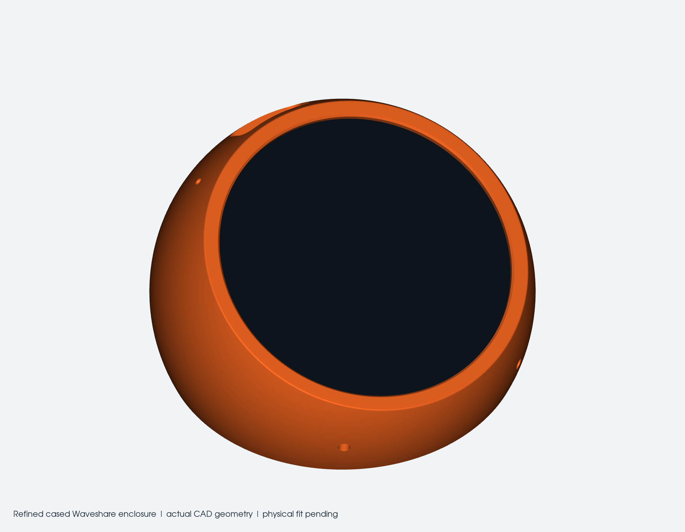

# Waveshare OpenHarness

OpenHarness firmware and a printable desktop enclosure for the **Waveshare ESP32-S3-Touch-AMOLED-1.75-B**, retaining its stock protective case and the supplied rounded **30 x 20 x 7 mm** speaker.

The physical device runs the board-specific firmware and connects over native USB to the official Harness desktop app. A live OpenHarness-managed Claude Code session was validated. The enclosure is a **CAD-checked prototype awaiting a physical print/fit test**.



## Hardware

- Waveshare ESP32-S3-Touch-AMOLED-1.75-B: standard board with protective case. This is **not the 1.75C**.
- ESP32-S3, 16 MB flash, 8 MB PSRAM; CO5300 AMOLED, CST9217 touch, AXP2101, ES7210 and ES8311.
- Retained case: nominal 51 mm diameter, 12.1 mm deep.
- Supplied 2030 Type-B 8-ohm / 2 W speaker; published 30 x 20 x 6.8 mm, measured just under 7 mm high.
- USB-C exits **at the top / 12 o'clock** with the current firmware and enclosure. Rotate the complete cased unit clockwise a quarter-turn from the original left-port orientation; the firmware counter-rotates the image and maps touch to match.

## What is here

| Folder | Contents |
|---|---|
| [`firmware/`](firmware) | Full OpenHarness firmware source snapshot with the Waveshare standard-board port applied |
| [`hardware/enclosure/`](hardware/enclosure) | Editable CAD generator, assembly STEP, individual STEP/STL parts, fit coupons and geometry checks |
| [`releases/firmware/`](releases/firmware) | Board-specific binary set, addresses, orientation and SHA-256 manifest |
| [`examples/waveshare-usb-test/`](examples/waveshare-usb-test) | Minimal display, touch and USB PING/PONG bring-up application |
| [`patches/`](patches) | Firmware port patch against the original full OpenHarness repository |
| [`docs/validation/`](docs/validation) | Validation record and sanitized build/test/flash logs |

## Print the enclosure

**Refined Rev B** has three main printed parts: a smooth one-piece shell with a continuous front rim, an underside display/speaker cartridge, and the speaker strap. USB-C uses a rounded tunnel behind the rim. There are no front screws; two countersunk screws close the underside. The supplied speaker lies flat above the hidden grille.

Start with **Case_Fit_Coupon**, **Speaker_Fit_Coupon**, and the new **USB_Rim_Fit_Coupon**, which reproduces the actual front collar and cable entry. Then print the housing, Base_Carrier and strap. The old separate bezel, speaker cradle and bottom cover are superseded. Use rubber feet to keep the underside sound path clear.

See the [enclosure guide](hardware/enclosure/README.md) for tolerances, fasteners, printing, assembly and unresolved physical checks. All supplied print STLs are watertight, consistently wound single-component meshes. The reference assembly has zero calculated component overlap, a checked continuous front rim, and checked case/cartridge insertion samples. This does not guarantee a physical fit or acoustic performance.

## Build firmware

Activate **ESP-IDF v5.5.4** and run:

```sh
idf.py -C firmware -B "$PWD/build/firmware" -DDEVICE_BOARD=waveshare-standard build
```

Change rotation on the board: **hold the dashboard face → Tabs → Controls → Display rotation**, then select USB Left, Top, Right, or Bottom. It is saved through power cycles and applied with a brief device restart. The default is Top for the current enclosure. `DEVICE_USB_POSITION=top` (or `left`) only chooses the fallback when no valid preference is saved. Rotation uses a CPU-only PSRAM strip and the existing two DMA buffers, preserving native panel addressing. The profile uses audio MCLK **GPIO42**, reads the PWR key through **TCA9554 P4**, and avoids probing SD pins as alternate reset lines. The device reports `waveshare-standard-1.75`, so the tested host refuses to replace it with incompatible stock dial firmware. The firmware binary retains the upstream `0.0.94` version string; the board identity and release SHA-256 manifest distinguish this port.

Use the [firmware guide](firmware/README.md) for flashing and recovery. Save a full local flash backup before changing a new device. **Full flash backups are intentionally not committed** because they can contain settings or credentials. No eFuses or ROM-download restrictions were changed on the tested unit.

## Host workflow

Install the [official Harness desktop app](https://harness.autonomous.ai/desktop), start it, and connect the board by USB. Host version **0.5.9** was validated. Select a Claude Code session in the app to display it on the device. Claude Code must be installed, signed in and authorized for the project. Close the app and stop its daemon before using esptool or a serial monitor.

The temporary account permission allowing agents to start other agents was restored to **off** after the smoke test. Manual session creation in the app is unaffected. No account state, credentials, daemon runtime or account-specific launchers are stored here.

## Validation and limits

See the [saved rotation validation](docs/validation/rotation-setting.md) and [fixed USB-top revision record](docs/validation/usb-top.md) for checks beyond the initial bring-up evidence below.

**Saved rotation confirmed on actual hardware:** selecting Left and then Top saves, restarts, and keeps the dashboard and touch aligned. The unit is currently set to Top.

**Passed on actual hardware during initial bring-up:** firmware build/flash hash checks, boot and PSRAM test, display, physical touch, native USB session, clean framed traffic, codec initialization, microphone data reaching host STT, and a live Claude reply: `Waveshare dashboard connected.`

**Passed offline:** the upstream host firmware test runner; CAD solid validity, connected parts, pairwise component clearance, and STL manifold/winding checks. The test runner's additional cJSON integration block is conditional on an activated `IDF_PATH`; see [validation details](docs/validation/README.md).

**Still needs physical testing:** printed enclosure fit and port alignment, PWR-button behavior, speaker sound/voice quality, battery operation, and an actual on-device OTA recovery cycle. Do not treat simulated OTA tests as a hardware recovery test.

## Upstream and licenses

Firmware base: [`autonomous-ai/openharness`](https://github.com/autonomous-ai/openharness), commit **a270d3e787aed01e9b204abd11b0d8952a4fc071**. This repository is a focused hardware port, not the complete upstream desktop/CLI monorepo. The patch is already applied here.

The enclosure is a new parametric spherical remodel inspired by the upstream round/tilted housing and its clean face, sized for the retained Waveshare case and speaker. Upstream geometry is kept for reference and attribution. See [NOTICE](NOTICE.md), the [MIT license](LICENSE), and the manufacturer references linked in the enclosure guide. Vendor material retains its own rights.
