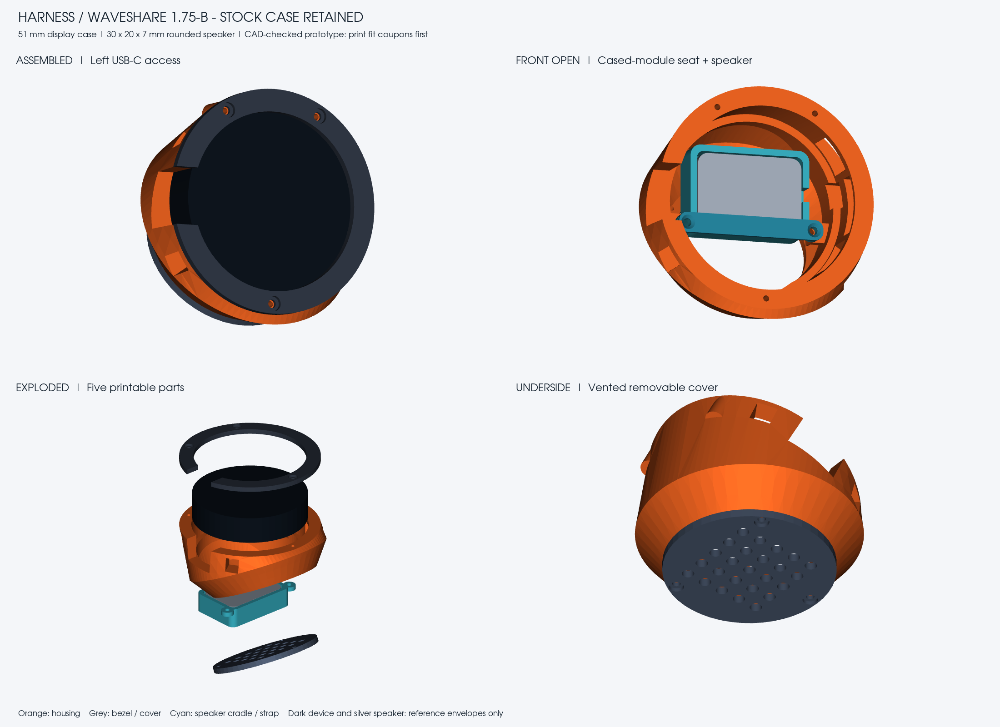

# Harness enclosure for the cased Waveshare 1.75-B

**Prototype: CAD and mesh checks passed; no physical print/fit test has been performed. Print both fit coupons before the full housing.**

This enclosure retains the stock protective case on the Waveshare ESP32-S3-Touch-AMOLED-1.75-B sold in [the linked Amazon listing](https://www.amazon.com/dp/B0F8868KK8). It accommodates the supplied rounded 2030 Type-B speaker. Orient the unit with the current display text upright: **USB-C at 9 o'clock / left-center**, microSD access at the right, and PWR/BOOT access on the right-hand diagonals.

The enclosure was remodeled from the round, tilted form and dimensions of the Autonomous OpenHarness STEP housing. It is larger and has new mounting internals. The original imported trimmed/offset surfaces failed modification booleans, so this version uses clean parametric lofts rather than claiming to preserve every original surface. The original STEP is retained under `source/` for provenance.



## Download / print parts

Print **one of each** from `stl/`:

| Part | Function |
|---|---|
| Housing_Waveshare_Cased | Main shell, cased-module seat, speaker rails, side access |
| Front_Bezel | Removable retaining bezel; cable clearance notch on the left |
| Speaker_Cradle | Rounded speaker pocket, protected rim supports, grille and wire exit |
| Speaker_Strap | Holds the speaker's closed back; does not press its diaphragm |
| Bottom_Cover | Removable vented underside |

First print `Case_Fit_Coupon` and `Speaker_Fit_Coupon`. The case ring should slide over the case without force; the speaker should enter the rounded pocket freely. These verify the two pocket dimensions, not the full depth stack or connector alignment. Inspect the sliced body before committing to a complete print.

STLs and individual STEPs use print orientation in millimeters. The combined `step/Harness_Waveshare_Cased_Assembly.step` uses assembled positions and contains **non-printable reference envelopes** for the device and speaker; do not print the assembly as one fused object.

## Dimensions and clearances

| Feature | Design value |
|---|---:|
| Stock protective case | 51.0 mm diameter x 12.1 mm depth |
| Case bore | 51.6 mm diameter: 0.30 mm radial clearance |
| Rear seat depth from bezel interface | 12.6 mm, allowing about 0.5 mm for rim padding |
| Visible bezel opening | 49.8 mm; avoids the nominal 48.96 mm glass outline |
| Speaker nominal body | 30 x 20 x 7.0 mm, rounded corners |
| Speaker pocket | 30.8 x 20.8 mm, R2 internal corners |
| Speaker retained depth | 7.2 mm between rim seats and strap |
| Left USB body relief | 16 mm tangential width x 11 mm axial height |
| Base cover | 48 mm diameter x 2.4 mm thickness |
| Display plane | 26 degrees above the desk plane |
| Main front diameter | About 62.4 mm; wider belly about 63 mm |

The supplied speaker's published working height is 6.8 +/- 0.3 mm; the user measured just under 7 mm. The 7.0 mm reference body is a conservative nominal envelope, not a scanned speaker. Its rim is supported above the grille; the acoustic face points toward the underside plenum. The cable exits on the right side of the cradle and has a relief opening.

The cased-unit drawing specifies the overall diameter/depth but does not fully dimension every port center. USB orientation was confirmed on the physical running unit by the user. Mic, button and microSD openings follow the rotated drawing layout with generous relief. **Their final alignment, the USB cable overmold, and component depth/stack must still be physically checked.** No PCB, connector or antenna model is claimed as a complete exact solid in the assembly.

## Hardware

- 6 x M2 x 8 mm plastic self-tapping **pan-head** screws: 3 for the front bezel, 3 for the bottom cover. Counterbores are 4.2 mm diameter.
- 2 x M2 x 8 mm plastic self-tapping **countersunk** screws: speaker strap and cradle into the housing rails.
- About 0.5 mm soft foam on the cased unit's **outer rear rim**, clear of the PCB and connectors. Check the stack; do not compress the glass.
- Optional very thin foam on the speaker's closed back if it rattles; available depth clearance is small.
- 4 adhesive rubber feet, at least 1.5 mm high, to keep the downward sound/vent holes clear of the desk.

Pilot holes are 1.7 mm. These are for plastic self-tapping screws, not modeled M2 machine threads or heat-set inserts. Confirm screw fit on scrap and tighten gently. The upstream USB clamp, separate port PCB, button actuator and iron base are not required in this version.

## Printing and assembly

Starting point: PETG, 0.4 mm nozzle, 0.2 mm layers, 4 perimeters, 4-5 top/bottom layers, 15-25% infill. PLA can serve as a fit prototype. The STL orientations put the main housing on its flat base and the smaller parts flat. Review support needs under connector windows and the cradle's screw ears; keep supports removable from the case seat and grille. Printer tuning determines final fit.

1. Print and check both coupons. Do not force either component into a tight print; adjust clearances first.
2. Place the speaker in its cradle with the acoustic face toward the cradle grille and its closed back toward the strap. Route its leads through the right-hand relief.
3. With the display out, install cradle and strap on the two internal rails using the countersunk screws. Do not clamp the diaphragm. Route the leads to the existing speaker connector without pinching or tension.
4. Pad the outer case seat lightly. Insert the complete cased module from the front, aligning USB-C to the left cutout. Keep the PCB, antennas and rear connectors clear.
5. Fit the C-shaped front bezel, with its notch at the USB side. Confirm the cable can fully seat, then secure the three bezel screws gently. The bezel retains the protective case rim rather than loading the glass.
6. Check PWR/BOOT, microphone and card access before closing. Attach the bottom cover and rubber feet. Verify touch, USB and speaker operation again after assembly.

## Editable CAD and checks

Use Python 3.12 in a virtual environment. The CAD dependencies are sizable; allow several GB of disk space. Install the pinned requirements, then run:

```sh
python -m pip install -r source/requirements.txt
python source/build_enclosure.py
python source/check_meshes.py
python source/render_preview.py
```

The script's parameter table controls the fit dimensions; some mounting geometry is specific to this layout. Treat larger parameter changes as a redesign and recheck the complete assembly. The generator rejects invalid/disconnected solids and material interference above 0.03 mm^3. The mesh checker requires watertight, consistently wound, single-component STL parts. `validation.json` records dimensions, volumes, mesh results and pairwise assembly checks.

The current reference assembly has zero calculated material overlap. These checks do not establish physical fit, acoustic performance, minimum wall strength, cable strain resistance or print durability.

## Sources and attribution

- Autonomous OpenHarness hardware, base commit `a270d3e787aed01e9b204abd11b0d8952a4fc071`: https://github.com/autonomous-ai/openharness/tree/main/devices/harness-device/hardware
- Official cased-unit dimensions: https://files.waveshare.com/wiki/ESP32-S3-Touch-AMOLED-1.75/ESP32-S3-Touch-AMOLED-1.75-B-3D.zip
- Official board resource page: https://docs.waveshare.com/ESP32-S3-Touch-AMOLED-1.75/Resources-And-Documents
- Supplied speaker identification from the official board package image `8-2W-2030-Speaker-B_220.jpg`; Type-B speaker dimensions: https://www.waveshare.com/product/luckfox/8ohm-2w-speaker-b.htm

Manufacturer drawings are reference documents and retain their owners' rights. The upstream MIT notice is included in `source/UPSTREAM_LICENSE.txt`.
