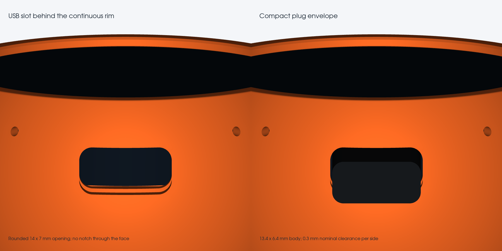

# Refined Harness enclosure — Rev B

**CAD-checked prototype. Physical print, cable fit and complete wired assembly have not been verified. Start with the three fit coupons.**

This revision follows the original Autonomous enclosure's clean face and rounded body: a continuous integral front rim, no front screws, and a rounded USB tunnel behind the rim. It retains the Waveshare 1.75-B protective case and supplied rounded 30 × 20 × 7 mm speaker. The shell is a new analytic spherical remodel inspired by the original; its surfaces and dimensions are not identical to the original imported STEP.


Use **Top** in the board's Display rotation setting. USB-C stays at 12 o'clock. The factory case remains installed.

## Parts

Print one of each main part from `stl/`:

| Part | Purpose |
|---|---|
| `Housing_Waveshare_Cased` | One-piece rounded shell, integral front rim, USB tunnel and small service bores |
| `Base_Carrier` | Removable underside, display cradle, horizontal speaker pocket, hidden grille and mounting pillars |
| `Speaker_Strap` | Retains the speaker's closed back; keeps pressure off its acoustic face |

The former separate Front_Bezel, Speaker_Cradle and Bottom_Cover are superseded. They do not belong in this assembly. The strap keeps the prior fit dimensions. Do not mix the old housing/base with the new cartridge.

`step/Harness_Waveshare_Cased_Assembly.step` contains the assembled parts and simplified case, speaker and compact-plug reference envelopes. Those reference objects are not printable parts. Individual STEP/STL files use print orientation in millimeters.


## Fit coupons first

- **Case_Fit_Coupon:** 51.6 mm bore for the nominal 51 mm case. Confirm a free sliding fit.
- **Speaker_Fit_Coupon:** 30.8 × 20.8 mm pocket with R2 corners. Confirm the supplied rounded speaker fits without force.
- **USB_Rim_Fit_Coupon:** an 11 mm-deep section of the actual shell, including its continuous rim, USB tunnel and service bores. Seat the complete cased unit from behind, orient USB at the top, and check that your cable fully inserts without loading the case or rim. Verify button/microphone alignment before the full print.

The USB and service-hole depths are inferred from the manufacturer's drawing; that drawing does not dimension every center. The USB opening was moved 5 mm farther behind the face after the first physical housing showed the connector against the opening's lower edge. The reference plug body is **13.4 mm wide × 6.4 mm thick**, with 0.3 mm nominal clearance per side in a 14 × 7 mm slot. Your cable's overmold may differ. Reprint and test the USB rim coupon with the actual unit/cable before printing the full housing.



## Dimensions

| Feature | Nominal value |
|---|---:|
| Retained protective case | Ø51.0 × 12.1 mm |
| Front retention aperture | Ø49.8 mm; clears nominal Ø48.96 glass |
| Front outside diameter | Ø55.2 mm before the 0.35 mm edge radius |
| Face opening bevel | 0.35 mm; approximately 2.2 mm visible flat surround |
| Case front behind the face | 1.5 mm |
| Nominal front rim padding allowance | 0.2 mm |
| Main spherical skin | 1.9 mm nominal |
| Top USB slot | 14 × 7 mm, R2 corners, center 10.3 mm behind face |
| Material above USB slot | 6.8 mm to the face plane; no break in the front rim |
| PWR/BOOT service bores | Ø2.0 mm, lower diagonals |
| Microphone bores | Ø1.4 mm, upper diagonals |
| Speaker pocket | 30.8 × 20.8 mm; retained depth 7.2 mm |
| Underside plate | 2.4 mm thick; two flush countersinks |
| Display plane angle | 26° above desk |
| Overall assembly | Approximately 64 × 64 × 38.5 mm |

The microSD slot is serviced through the underside after lifting out the carrier and releasing the cased module. There is no external card-slot window.

## Hardware and print finish

- **4 × M2 × 8 mm countersunk screws:** two underneath, two inside on the speaker strap. The modeled heads are up to 4.0 mm diameter with a 90° countersink; pilot bores are 1.7 mm. Use a screw suitable for forming a thread in plastic, verify the fit on scrap, and tighten gently. No metal thread or insert is modeled.
- Thin soft foam on the stock case's **plastic rim only**, if needed to take up print tolerance. Check the actual plastic/glass stack before tightening; the front rim must not clamp the glass.
- Three or four thin rubber feet, at least 1.5 mm high, placed clear of the underside grille and fixing holes.

Suggested starting point: PETG, 0.4 mm nozzle, 0.12–0.16 mm layers on the exterior, four perimeters, and 4–5 top/bottom layers. The outer sphere and rounded edge are real CAD geometry; the STLs use 0.015 mm / 0.05-radian tessellation limits. The case and speaker pockets still depend on printer calibration.

Print the shell on its underside mating edge and the cartridge on its flat underside. Inspect support needs under the USB tunnel and the cartridge's raised display cradle/strap ears. Keep supports removable from mating surfaces, service bores and the speaker pocket. The cartridge's supported surfaces are internal; avoid scarring the visible front rim. Inspect the sliced parts before printing.

## Assembly

1. Print and check all three coupons. Stop to adjust the fit parameters if the case, speaker or plug binds.
2. Place the speaker in the cartridge's horizontal pocket, with its acoustic face toward the underside grille. Route its leads through the pocket's side relief. Fit the strap to the closed back using two countersunk screws; do not press the diaphragm.
3. Support the empty shell face-down on a soft, rim-supporting surface. Keep the glass off the work surface. Insert the **complete cased unit** from the underside, USB toward the rounded top tunnel. Enter toward the middle of the enclosure, then move it along the display normal into the front lip. The geometric entry offset is about 3.7 mm horizontally and 7.6 mm below its seated position; the module cannot enter through the smaller front aperture.
4. Connect the speaker and leave slack clear of the case rim, display cradle, screw bosses and grille. Rear connectors and wires are not included in the simplified case envelope; inspect their actual clearance.
5. Insert the cartridge from underneath. Its raised circular register cups the **outer rear plastic case rim** and locates the display; the speaker stays flat underneath. Ensure the case is seated against the front rim with light rim padding as needed. Do not force the cartridge against a trapped cable or connector.
6. Secure the two underside countersunk screws gently. Both heads should sit flush or below the underside. Add rubber feet clear of the sound slots.
7. Check USB insertion/removal, touch, PWR/BOOT access, microphone and speaker operation after closing. To service microSD or the electronics, unplug USB and remove the underside cartridge.

## Editable CAD and verification

Use Python 3.12 with the pinned CAD dependencies:

```sh
python -m pip install -r source/requirements.txt
python source/build_enclosure.py
python source/check_meshes.py
python source/render_preview.py
```

The generator checks solid validity, connected printable parts, pairwise assembly interference, cartridge containment within the exterior, a full 360° front-rim band, and a sampled two-stage display insertion path. It also samples the cartridge's vertical insertion. `validation.json` records the inputs and results. The rendering script uses the exported CAD meshes and recorded coordinate frame; the images are not substitutes for the model.

Passed for the current simplified envelopes: six valid single solids; six watertight, consistently wound single-component meshes; zero pairwise material overlap; zero cartridge/device protrusion; an unbroken front rim; 245 display insertion samples with 0.1 mm envelope margin and at most 0.2 mm between samples; nine cartridge insertion samples. These checks do not model actual wires, connector protrusions, fastener threads, acoustic performance or FDM strength. The physical fit remains to be tested.

## References and attribution

- Autonomous OpenHarness housing and upstream MIT license, base commit `a270d3e787aed01e9b204abd11b0d8952a4fc071`: https://github.com/autonomous-ai/openharness/tree/main/devices/harness-device/hardware
- Official cased-unit drawing: https://files.waveshare.com/wiki/ESP32-S3-Touch-AMOLED-1.75/ESP32-S3-Touch-AMOLED-1.75-B-3D.zip
- Board resources: https://docs.waveshare.com/ESP32-S3-Touch-AMOLED-1.75/Resources-And-Documents
- Supplied Type-B 2030 speaker: https://www.waveshare.com/product/luckfox/8ohm-2w-speaker-b.htm

`source/Original_Housing.step` and `source/UPSTREAM_LICENSE.txt` retain the original design's provenance. Manufacturer documents retain their owners' rights and are linked rather than republished.
